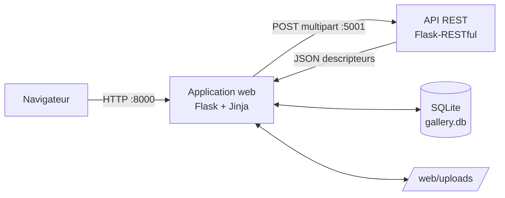

# 🖼️ Galerie CBIR — recherche d'images par le contenu

Application web de **recherche d'images par similarité visuelle** (*Content-Based Image Retrieval*).
Chaque image est décrite par ses couleurs et ses textures ; on retrouve ensuite les images qui lui ressemblent, puis on affine les résultats grâce au **retour de pertinence (Rocchio)**.


---

## Sommaire

- [Fonctionnalités](#fonctionnalités)
- [Architecture](#architecture)
- [Installation et lancement](#installation-et-lancement)
- [Importer la base GHIM-10K](#importer-la-base-ghim-10k)
- [API REST](#api-rest)
- [Descripteurs visuels](#descripteurs-visuels)
- [Recherche par similarité](#recherche-par-similarité)
- [Structure du projet](#structure-du-projet)
- [Configuration](#configuration)

---

## Fonctionnalités

**Galerie**
- Comptes utilisateurs (inscription / connexion, mots de passe hachés) — chaque utilisateur ne voit que ses images.
- Import d'une ou plusieurs images (JPG, PNG, BMP, GIF, WebP, TIFF).
- Catégories et sous-catégories imbriquées, images « non classées ».
- Tri (date, nom, taille), pagination (60 images par page).
- Actions groupées : télécharger en ZIP, déplacer, supprimer.

**Analyse d'une image**
- Affichage détaillé des 5 descripteurs (histogrammes, moments, couleurs dominantes, GLCM, LBP).
- Export des descripteurs en JSON, recalcul à la demande.

**Transformations** (avec aperçu en direct, enregistrées comme nouvelle image)
- Recadrage, redimensionnement (plus proche voisin / bilinéaire / bicubique), rotation, miroir horizontal ou vertical, niveaux de gris, luminosité.
- Les étapes s'enchaînent dans l'ordre choisi ; l'original est conservé.

**Recherche**
- Recherche simple par l'exemple : 12, 24 ou 48 résultats.
- Choix des descripteurs comparés et de la distance (euclidienne, Manhattan L1, cosinus).
- Retour de pertinence itératif (Rocchio) avec α, β, γ réglables.
- Précision affichée par rapport à la catégorie de l'image requête.

---

## Architecture

Le projet est découpé en **deux services** indépendants :



| Service | Port | Rôle |
|---|---|---|
| **API REST** (`api/`) | 5001 | Calcule les descripteurs d'une image (NumPy + Pillow), sans état. |
| **Application web** (`web/`) | 8000 | Comptes, galerie, catégories, transformations, recherche et retour de pertinence. Stocke les images, les descripteurs (JSON) et les vecteurs de recherche (`float32`) dans SQLite. |

---

## Installation et lancement

**Prérequis :** Python 3.10 ou plus récent.

### Linux / macOS

```bash
python3 -m venv .venv
.venv/bin/pip install -r requirements.txt

.venv/bin/python api/app.py      # terminal 1 : API         → http://127.0.0.1:5001/api/descriptors
.venv/bin/python web/app.py      # terminal 2 : application → http://127.0.0.1:8000
```

### Windows (PowerShell)

```powershell
python -m venv .venv
.venv\Scripts\pip install -r requirements.txt

.venv\Scripts\python api\app.py  # terminal 1 : API
.venv\Scripts\python web\app.py  # terminal 2 : application
```

Ouvrir ensuite <http://127.0.0.1:8000/register>, créer un compte, puis se connecter.

> ⚠️ L'API doit tourner **avant** d'importer des images : l'application web l'appelle pour calculer les descripteurs.

Au premier lancement, l'application crée automatiquement `web/gallery.db`, `web/uploads/` et `web/.secret_key` (tous ignorés par Git).

### Vérifier les descripteurs

```bash
python api/descriptors.py   # affiche « OK » si les tests d'auto-vérification passent
```

---

## Importer la base GHIM-10K

1. Télécharger [GHIM-10K sur Kaggle](https://www.kaggle.com/datasets/mcpython/ghim-10k) et dézipper l'archive.
2. Créer un compte dans l'application.
3. L'API étant lancée, exécuter :

```bash
.venv/bin/python web/import_dataset.py chemin/vers/GHIM-10K nom_utilisateur
```

Le dossier devient une **catégorie racine** et chaque sous-dossier une **sous-catégorie**. Les images sont envoyées à l'API par lots de 50 ; la progression s'affiche dans le terminal. Les catégories servent ensuite de vérité terrain pour calculer la précision.

---

## API REST

URL de base : `http://127.0.0.1:5001`

| Méthode | URL | Rôle |
|---|---|---|
| `GET` | `/api/descriptors` | Liste des descripteurs disponibles |
| `POST` | `/api/descriptors` | Tous les descripteurs, pour une ou plusieurs images (champ multipart `images`) |
| `POST` | `/api/descriptors/<nom>` | Un seul descripteur : `color_histogram`, `color_moments`, `dominant_colors`, `glcm`, `lbp` |

**Exemples**

```bash
# Tous les descripteurs pour deux images
curl -F images=@photo1.jpg -F images=@photo2.jpg http://127.0.0.1:5001/api/descriptors

# Seulement la texture LBP
curl -F images=@photo1.jpg http://127.0.0.1:5001/api/descriptors/lbp
```

**Réponse**

```json
{
  "results": [
    {
      "filename": "photo1.jpg",
      "width": 384,
      "height": 256,
      "descriptors": { "color_histogram": { "r": [...], "g": [...], "b": [...] }, "...": "..." }
    }
  ]
}
```

**Erreurs :** `400` si aucun fichier, fichier illisible ou image plus petite que 3×3 px ; `404` si le descripteur demandé n'existe pas.

---

## Descripteurs visuels

| Descripteur | Type | Paramètres | Dimension |
|---|---|---|---|
| **Histogrammes de couleur** | Couleur | 32 bins par canal R, G, B, normalisés | 96 |
| **Moments de couleur** | Couleur | Moyenne, écart-type, asymétrie par canal | 9 |
| **Couleurs dominantes** | Couleur | 5 couleurs (median-cut affiné par k-means) + proportion | 20 |
| **GLCM** | Texture | 16 niveaux de gris, distance 1, directions 0°/45°/90°/135° ; contraste, dissimilarité, homogénéité, énergie, ASM, corrélation, entropie (moyenne des 4 directions) | 7 |
| **LBP** | Texture | Motifs uniformes, P = 8, R = 1 (58 uniformes + 1 « non uniforme ») | 59 |
| | | **Total** | **191** |

---

## Recherche par similarité

### Recherche simple

1. Les 5 descripteurs sont concaténés en un **vecteur de 191 valeurs**.
2. Chaque dimension est **normalisée (z-score)** sur l'ensemble de la collection de l'utilisateur.
3. Chaque bloc est pondéré par `1/√n` (n = sa dimension) pour que **chaque descripteur pèse autant** dans la distance, quelle que soit sa taille.
4. Les images sont classées par distance croissante à la requête — euclidienne, Manhattan (L1) ou cosinus, au choix.

On peut restreindre la comparaison à certains descripteurs (par exemple uniquement la texture).

### Retour de pertinence — Rocchio (*Query Vector Modification*)

L'utilisateur marque les résultats **pertinents** (R) et **non pertinents** (N), puis la requête est déplacée dans l'espace des descripteurs :

$$
Q' = \alpha \cdot Q + \beta \cdot \overline{R} - \gamma \cdot \overline{N}
$$

| Paramètre | Rôle | Défaut | Plage |
|---|---|---|---|
| α | Poids de la requête courante | 1,00 | 0 – 2 |
| β | Attraction vers les pertinents | 0,75 | 0 – 2 |
| γ | Répulsion des non pertinents | 0,25 | 0 – 2 |

Les valeurs se règlent sur la page de recherche ; les défauts sont définis dans `web/app.py`. Chaque itération repart du Q' précédent.

### Précision

La **précision** affichée est la part des résultats appartenant à la même catégorie que l'image requête (la vérité terrain de GHIM-10K après import).

---

## Structure du projet

```
galerie-cbir/
├── api/
│   ├── app.py              # API REST Flask-RESTful (port 5001)
│   └── descriptors.py      # Calcul des descripteurs + auto-vérification
├── web/
│   ├── app.py              # Application web (port 8000)
│   ├── import_dataset.py   # Import d'un dossier d'images (ex. GHIM-10K)
│   └── templates/          # Pages HTML (Jinja)
│       ├── base.html, macros.html, auth.html
│       ├── gallery.html    # Galerie et catégories
│       ├── image.html      # Détail et descripteurs d'une image
│       ├── transform.html  # Éditeur de transformations
│       ├── search_pick.html, search.html   # Recherche et retour de pertinence
├── requirements.txt
└── README.md
```

---

## Configuration

| Variable / constante | Où | Défaut | Rôle |
|---|---|---|---|
| `API_URL` (variable d'environnement) | `web/app.py` | `http://127.0.0.1:5001/api/descriptors` | Adresse de l'API de descripteurs |
| `ALPHA`, `BETA`, `GAMMA` | `web/app.py` | 1,0 / 0,75 / 0,25 | Valeurs par défaut de Rocchio |
| `PER_PAGE` | `web/app.py` | 60 | Images par page dans la galerie |
| `MAX_CONTENT_LENGTH` | `api/app.py`, `web/app.py` | 500 Mo | Taille maximale d'un envoi |
| `HIST_BINS`, `N_COLORS`, `GLCM_LEVELS` | `api/descriptors.py` | 32 / 5 / 16 | Paramètres des descripteurs |

> Si vous modifiez les paramètres des descripteurs, mettez aussi à jour `BLOCKS` dans `web/app.py` et recalculez les descripteurs des images existantes.

---

## Technologies

Python · Flask · Flask-RESTful · NumPy · Pillow · SQLite · Jinja2 · Requests
